# Smart Retail Analytics
**Machine Learning-Based Sales Forecasting, Customer Segmentation and Product Demand Prediction**

An end-to-end interactive Data Science and Predictive Analytics platform built with Python, Streamlit, Plotly, Scikit-Learn, and XGBoost on the Sample Superstore retail dataset. All financial metrics and predictions are calibrated in **Indian Rupees (₹)** at current operational exchange rates.

[](https://github.com/shidamrohan/Data-Science-cp.git)
[](https://www.kaggle.com/datasets/vivek468/superstore-dataset-final)
[](https://streamlit.io/)
[](https://www.python.org/)

---

## 📌 Business Questions Answered

| Module | Core Business Question | Business Impact |
|--------|------------------------|-----------------|
| **Executive Dashboard** | How much revenue and profit does the business generate? | High-level performance KPIs & monthly velocity |
| **Sales Analytics** | Which products, categories, and regions perform best? | Identifies regional growth & the *Discount Trap* |
| **Sales Forecast** | What revenue will the business generate next month? | Multi-model regression with 6-month projections |
| **Demand Forecast** | How many units will each product/sub-category require? | Reorder recommendations & stockout risk prevention |
| **Customer Segmentation** | Who are the most valuable customers? | RFM + K-Means ($K=4$) persona-based targeting |
| **Product Analytics** | What actions should the business take on products? | Star vs Loss-leader detection with automated actions |
| **Model Performance** | Which algorithm predicts sales with highest accuracy? | Benchmark of Linear Regression vs Random Forest vs XGBoost |

---

## 📊 Dataset Information

This project leverages the **Sample Superstore Dataset**, a widely recognized benchmark retail transaction dataset containing historical order records across multiple consumer segments, product categories, and geographic regions.

- **Dataset Source:** [Kaggle - Superstore Dataset (Final)](https://www.kaggle.com/datasets/vivek468/superstore-dataset-final)
- **Author / Curator:** Vivek Sharma
- **Total Records:** 9,994 order line items
- **Total Features:** 21 attributes (Categorical, Temporal, Numerical, Financial)
- **Time Horizon:** 4 full calendar years (January 2014 – December 2017)
- **Geographic Coverage:** United States (4 regions, 49 states, 531 cities)
- **Customer Base:** 793 distinct enterprise and retail clients
- **Product Catalog:** 1,850 unique items across 3 categories and 17 sub-categories

### 🗂️ Data Schema & Column Breakdown

| Attribute | Data Type | Category | Description & Business Meaning |
|---|---|---|---|
| `Row ID` | Integer | Metadata | Unique sequential row index (1 to 9,994) |
| `Order ID` | String | Order | Unique identifier for each retail purchase order |
| `Order Date` | Date (`YYYY-MM-DD`) | Temporal | Date the transaction was placed by the customer |
| `Ship Date` | Date (`YYYY-MM-DD`) | Temporal | Date the items were dispatched from fulfillment center |
| `Ship Mode` | String | Logistics | Shipping class (`Standard Class`, `Second Class`, `First Class`, `Same Day`) |
| `Customer ID` | String | Customer | Unique alphanumeric identifier for each customer |
| `Customer Name`| String | Customer | Full legal name of the purchaser |
| `Segment` | String | Customer | Consumer market segment (`Consumer`, `Corporate`, `Home Office`) |
| `Country` | String | Geography | Country of delivery (`United States`) |
| `City` | String | Geography | City of delivery (531 unique cities) |
| `State` | String | Geography | US State / Territory (49 states) |
| `Postal Code` | Numeric / String | Geography | Postal ZIP code for spatial routing |
| `Region` | String | Geography | Geographic territory (`Central`, `East`, `South`, `West`) |
| `Product ID` | String | Product | Unique inventory SKU identifier |
| `Category` | String | Catalog | Top-level product category (`Furniture`, `Office Supplies`, `Technology`) |
| `Sub-Category` | String | Catalog | Granular grouping (17 sub-categories: Chairs, Storage, Binders, Tables, etc.) |
| `Product Name` | String | Catalog | Full commercial name and model specification of the item |
| `Sales` | Float | Financial | Gross transaction revenue |
| `Quantity` | Integer | Operational | Total unit volume purchased in the line item |
| `Discount` | Float | Financial | Promotional markdown rate applied (ranges from `0.00` to `0.80`) |
| `Profit` | Float | Financial | Net operating earnings or losses generated on the sale |

### 💱 Currency Calibration (INR Conversion)
- The raw dataset records financial transactions in **USD ($)**.
- For regional enterprise applicability and accurate financial reporting, all monetary figures (`Sales`, `Profit`, `Revenue_Per_Unit`) are converted to **Indian Rupees (INR, ₹)** at an operational exchange rate:
  $$\text{1 USD} = \mathbf{₹95.28}$$
- **Full Value Formatting:** All UI figures and metrics avoid ellipsis clipping (`...`), rendering full values in the Indian numbering system (e.g., `₹2,19,01,962` or `₹2.19 Cr`).

---

## 🔄 End-to-End Analytics Workflow

The system follows a production-grade 10-step data science lifecycle:

```mermaid
flowchart LR
    A["1. Data Audit"] --> B["2. Preprocessing"]
    B --> C["3. EDA"]
    C --> D["4. Baseline Forecasts"]
    D --> E["5. Feature Engineering"]
    E --> F["6. Model Comparison"]
    F --> G["7. Inventory Logic"]
    G --> H["8. RFM Segmentation"]
    H --> I["9. Interactive Dashboard"]
    I --> J["10. Deployment"]
```



1. **Data Audit:** Verifies schema consistency, encoding variants (`utf-8`, `cp1252`), missing values, zero variance columns, and negative values.
2. **Preprocessing:** Handles date parsing, duplicate elimination, IQR ($\times 3$) outlier bounds, and INR currency conversion (`1 USD = ₹95.28`).
3. **Exploratory Data Analysis (EDA):** Evaluates profit margins across regions, seasonal volume spikes in Q4, and the **Discount Trap** (where discounts $>20\%$ destroy margin).
4. **Baseline Forecasts:** Establishes naive baseline metrics using historical moving averages and standard linear regression.
5. **Feature Engineering:** Builds temporal lags ($t-1, t-2, t-3$), rolling momentum windows (3-month and 6-month), and cyclical sine/cosine calendar transforms.
6. **Model Comparison:** Evaluates Linear Regression, Random Forest Regressor (200 estimators), and XGBoost on chronologically ordered 80/20 train/test splits.
7. **Inventory Logic:** Calculates unit demand forecasts, safety buffers ($+15\%$), automated reorder targets, and stockout risk tiers (High / Medium / Low).
8. **RFM Segmentation:** Derives Recency, Frequency, and Monetary scores per customer, applies `log1p` scaling + `StandardScaler`, and clusters into 4 retail personas via K-Means.
9. **Interactive Dashboard:** 6-page FinTech-themed Streamlit web interface with real-time scenario sliders, 2D/3D Plotly visualizers, and direct CSV/Excel data export.
10. **Deployment:** Pinned dependencies, automated CLI retraining pipeline (`src/train_all.py`), and version-controlled GitHub distribution.

---

## 🧠 Real Model Performance (Held-out Test Split)

| Model | MAE (₹) | RMSE (₹) | R² Score | Status |
|-------|---------|----------|----------|--------|
| **Random Forest Regressor** | **₹84,668** | **₹1,23,733** | **0.6122** | 🏆 **Best Model** |
| XGBoost Regressor | ₹92,203 | ₹1,31,774 | 0.5602 | Gradient boosted baseline |
| Linear Regression | ₹1,00,319 | ₹1,35,288 | 0.5364 | Classical linear baseline |

- **Product Demand Model (RF):** $R^2 = \mathbf{0.7104}$, $\text{MAE} = 14.80\text{ units}$
- **Customer Segmentation (K-Means $K=4$):** Silhouette Score = $\mathbf{0.2695}$
  - 👑 **VIP Customers:** High frequency, recent orders, highest lifetime spend.
  - ⭐ **Regular Customers:** Consistent purchase rhythm with solid margins.
  - 🎟️ **Occasional Shoppers:** Infrequent seasonal buyers requiring discount incentives.
  - ⚠️ **At-Risk Customers:** Historically high spenders with long inactivity; targeted for automated win-back campaigns.

---

## 🚀 Quickstart & Setup

### 1. Clone the repository
```bash
git clone https://github.com/shidamrohan/Data-Science-cp.git
cd Data-Science-cp
```

### 2. Create Virtual Environment & Install Dependencies
```bash
# Using standard venv
python -m venv .venv
.venv\Scripts\activate      # On Windows
source .venv/bin/activate    # On Linux/macOS

pip install -r requirements.txt
```

### 3. Run the Machine Learning Pipeline (One-shot)
```bash
python src/train_all.py
```
This script:
- Cleans and preprocesses the raw Superstore transaction records.
- Converts currency to INR (`1 USD = ₹95.28`).
- Engineers temporal lag features, rolling statistics, and cyclical seasonality.
- Builds and normalizes RFM features.
- Trains and saves all models: Linear Regression, Random Forest, XGBoost, and K-Means.

### 4. Launch the Interactive Dashboard
```bash
streamlit run app.py
```
Open **[http://localhost:8501](http://localhost:8501)** in your browser.

---

## 🛠️ Technology Stack

| Layer | Tools |
|---|---|
| **Frontend Dashboard** | Streamlit, Plotly Express & Graph Objects, Custom CSS FinTech Light Theme |
| **Machine Learning** | Scikit-Learn, XGBoost, SciPy |
| **Data Processing** | Pandas, NumPy, PyArrow |
| **Model Persistence** | Joblib |
| **Export Formats** | Excel (`openpyxl`), CSV, Parquet, Word (`python-docx`) |
| **Testing** | Standard library `unittest` / `pytest` |

---

## 📂 Project Architecture

```
smart-retail-analytics/
├── .streamlit/
│   └── config.toml                # FinTech Light UI theme configuration
│
├── data/
│   ├── raw/
│   │   └── SampleSuperstore.csv   # Benchmark retail transactions (9,994 rows)
│   └── processed/                 # Processed & feature-engineered Parquet datasets
│
├── docs/
│   ├── PROJECT_OVERVIEW.md        # Technical architecture, methodology & business rationale
│   └── Smart_Retail_Analytics_Project_Report.docx # Formatted academic & corporate Word report
│
├── models/                        # Pre-trained ML models & metadata (.pkl, .csv)
│   ├── demand_rf_model.pkl        # Demand forecasting Random Forest model
│   ├── sales_rf_model.pkl         # Sales revenue Random Forest model (Best R²=0.6122)
│   ├── kmeans_model.pkl           # Customer segmentation K-Means model (K=4)
│   └── sales_feature_importance.csv # Extracted feature weightings
│
├── notebooks/
│   └── EDA.ipynb                  # Interactive Jupyter exploratory data analysis
│
├── pages/
│   ├── 1_📊_Sales_Analytics.py      # Granular filters, trends & discount trap
│   ├── 2_📈_Sales_Forecast.py       # Live revenue forecast with growth predictor
│   ├── 3_📦_Demand_Forecast.py      # Inventory risk & recommended stock levels
│   ├── 4_👥_Customer_Segmentation.py # 2D/3D RFM cluster visualization & targeting
│   ├── 5_🏷️_Product_Analytics.py     # Margin rankings, loss leaders & recommendations
│   └── 6_🧠_Model_Performance.py    # Academic viva & model benchmarking page
│
├── src/
│   ├── __init__.py
│   ├── preprocessing.py           # Data cleansing & INR currency pipeline
│   ├── feature_engineering.py     # Lags, rolling averages, RFM builder
│   ├── formatters.py              # Full Indian number formatting (₹ Lakhs/Crores)
│   ├── ui_theme.py                # FinTech Light theme CSS, KPIs, Plotly layouts, Exporters
│   ├── train_sales.py             # Sales revenue regression (LR, RF, XGB)
│   ├── train_demand.py            # Unit volume demand forecasting
│   ├── clustering.py              # RFM normalization + K-Means (K=4)
│   ├── evaluation.py              # Metrics loader (MAE, RMSE, R², Silhouette)
│   └── train_all.py               # Complete end-to-end pipeline runner
│
├── tests/
│   ├── __init__.py
│   └── test_pipeline.py           # Pipeline validation unit tests
│
├── app.py                         # Executive Overview Dashboard (Home)
├── requirements.txt               # Pinned production dependencies
├── README.md                      # Comprehensive project guide & dataset info
└── .gitignore                     # Production Git ignore rules
```

---

## 📚 Documentation & Detailed Reports

- **Detailed Technical Specification:** [docs/PROJECT_OVERVIEW.md](docs/PROJECT_OVERVIEW.md) — Comprehensive documentation answering the What, Why, How, model design mathematics, and business rationale.
- **Academic & Corporate Word Report:** [docs/Smart_Retail_Analytics_Project_Report.docx](docs/Smart_Retail_Analytics_Project_Report.docx) — Formal Word report with tables, executive summaries, and methodology sections.
- **Exploratory Data Analysis Notebook:** [notebooks/EDA.ipynb](notebooks/EDA.ipynb) — Executable Jupyter notebook walking through data ingestion, currency conversion, visual charts, and customer RFM profiles.

